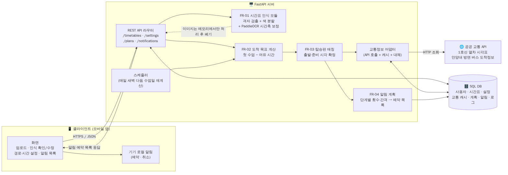
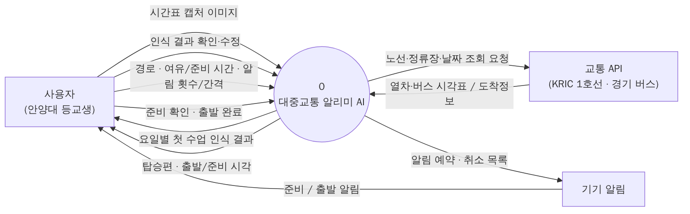
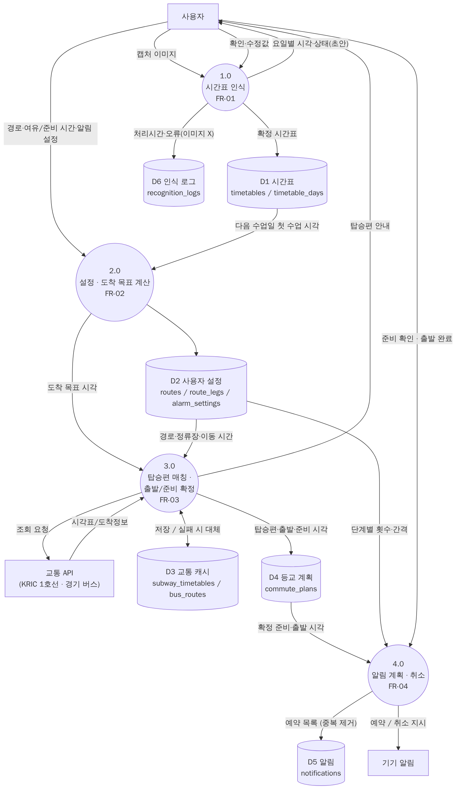
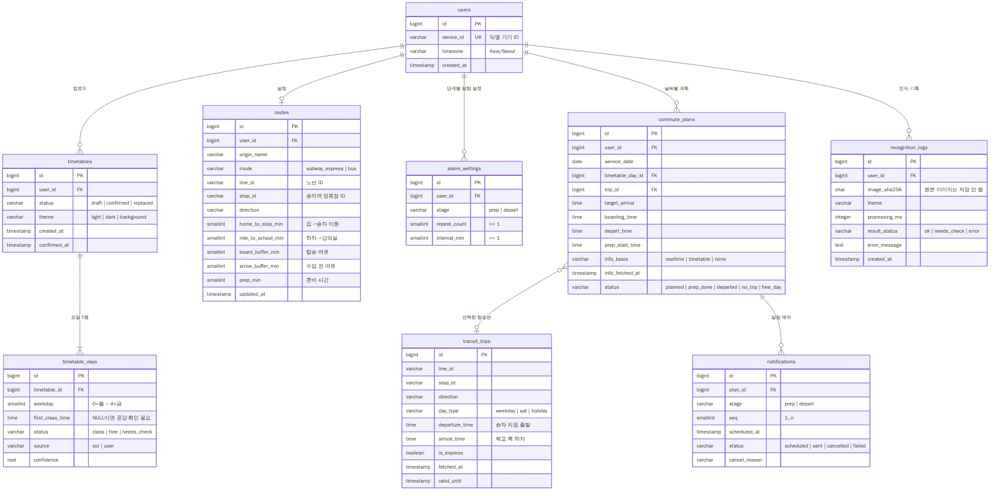

# 6주차 기술설계 — 시스템 구조도 · 데이터 흐름도 · DB 설계도 (초안 v0.1)

전제: **서버 FastAPI**, **DB SQL(PostgreSQL 기준)**, 근거 문서는 PRD v0.1 (FR-01~04, 3.2 비기능, 6.2 설계 입력).

| 도면 | 답하는 질문 | 파일 |
|---|---|---|
| 시스템 구조도 | 어떤 **부품**이 있고 서로 어떻게 연결되나 | `diagrams/1_system_architecture.*` |
| 데이터 흐름도 (DFD) | **어떤 데이터**가 어디서 와서 어떤 처리를 거쳐 어디에 쌓이나 | `diagrams/2_dfd_level0.*`, `3_dfd_level1.*` |
| DB 설계도 (ERD) | 쌓이는 데이터가 **어떤 표·열·관계**로 저장되나 | `diagrams/4_erd.*`, `schema.sql` |
| **ODsay → TAGO 연결 · FastAPI 방법** | 경로 검색 결과를 TAGO·KRIC에 잇는 절차와 엔드포인트 | **`odsay_tago_fastapi.md`** |
| **교통 API 결정서** | 구간별로 **어떤 API를 언제·어떤 조건으로** 부르고 어떻게 조합하나 | **`transit_api.md`**, `transit/`, `tools/check_transit_api.py` |

세 도면은 같은 이름을 공유해야 합니다: 구조도의 **모듈 = DFD의 프로세스(1.0~4.0) = FR 번호**, DFD의 **저장소 D1~D6 = ERD 테이블**. 이렇게 맞추면 "이 기능이 어떤 데이터를 쓰고 어디에 저장하나"를 세 도면으로 추적할 수 있습니다.

`.mmd`는 Mermaid 원본(GitHub에서 바로 렌더링, 수정 쉬움), `.png`는 보고서용 이미지입니다.

---

## 1. 시스템 구조도

### 주요 설계 결정
| 결정 | 이유 (PRD 근거) |
|---|---|
| **알림은 기기 로컬 알림으로 예약**, 서버는 "언제 울릴지" 목록만 계산 | 푸시 서버(FCM 등) 없이 MVP 가능, 네트워크가 끊겨도 울림. 권한 거부·예약 실패는 앱에서 표시 (3.2 알림 권한) |
| **이미지는 서버 메모리에서만 처리 후 폐기**, DB엔 해시·처리시간만 | 3.2 개인정보: "인식 직후 삭제, 요일별 시각·상태만 저장" |
| **교통정보 어댑터**를 별도 모듈로 분리 | 1호선 = KRIC, 버스 = 경기도 버스정보 v2로 확정 (`transit_api.md`). 실패 시 캐시 시각표로 대체 (3.2 안정성) |
| **스케줄러**(APScheduler 등)가 매일 새벽 다음 수업일 계획 재계산 | FR-03은 날짜마다 다른 열차편이 필요. 사용자가 앱을 안 열어도 계획이 준비됨 |
| OCR 모듈은 FastAPI 안의 함수로 시작 | MVP 규모에선 별도 서버 불필요. 느리면 나중에 작업 큐로 분리 |

### FastAPI 엔드포인트 초안
| 메서드 | 경로 | FR | 설명 |
|---|---|---|---|
| POST | `/timetables/recognize` | 01 | 이미지 업로드 → 요일별 시각·상태 초안 (이미지 저장 안 함) |
| PUT | `/timetables/{id}/confirm` | 01 | 사용자가 확인·수정한 5요일 저장, 이전 확정본은 `replaced` |
| GET / PUT | `/settings/route` | 02 | 경로·이동/여유/준비 시간 |
| GET / PUT | `/settings/alarms` | 04 | 단계별 횟수·간격 |
| GET | `/plans?date=YYYY-MM-DD` | 03 | 해당 날 탑승편·출발·준비 시각 + 정보 기준 시각 |
| POST | `/plans/{id}/recalculate` | 02·03 | 설정 변경 시 재계산 → 알림 목록 갱신 |
| GET | `/plans/{id}/notifications` | 04 | 앱이 로컬 알림으로 예약할 목록 |
| POST | `/plans/{id}/prep-done` | 04 | 남은 준비 알림 취소 (AC-04-02) |
| POST | `/plans/{id}/departed` | 04 | 당일 잔여 알림 전체 취소 (AC-04-05) |

---

## 2. 데이터 흐름도 (DFD)

DFD는 **레벨 0(컨텍스트) → 레벨 1** 순서로 그립니다.
- **레벨 0**: 시스템 전체를 원 하나로 보고, 바깥(사용자·공공 API·기기 알림)과 주고받는 데이터만 표시
- **레벨 1**: 그 원을 FR 단위 프로세스로 쪼개고, 데이터 저장소(D1~D6)를 추가
- 표기 규칙: 사각형 = 외부 개체, 원 = 처리(동사), 원통 = 저장소, 화살표 = **데이터 이름**(동작 이름 아님). 제어 흐름("다음 단계로")은 그리지 않습니다 — 순서도와의 가장 큰 차이입니다.

### 레벨 0

### 레벨 1

점검 포인트: 모든 저장소는 들어오는 화살표와 나가는 화살표가 하나 이상 있어야 하고(D6은 평가·실패 분석으로 나감), 모든 프로세스는 입력과 출력이 있어야 합니다.

---

## 3. DB 설계도 (ERD)

| 테이블 | 역할 | 핵심 제약 |
|---|---|---|
| `users` | 익명 기기 ID 단위 사용자 | `device_id` 유일 |
| `timetables` | 업로드 1회 = 1행, draft → confirmed → replaced | 사용자당 confirmed 1개 (부분 유일 인덱스) |
| `timetable_days` | 시간표당 월~금 5행 | `status='class'` ⇔ 시각 있음 (CHECK) |
| `routes` | 경로 공통 시간 (수업 전 여유·탑승 여유·준비) | 시간 값 ≥ 0 |
| `route_legs` | 경로 구간 (걷기 / 1호선 / 버스), KRIC 역코드·경기 노선ID 저장 | 구간 종류별 필수값 CHECK |
| `alarm_settings` | 준비·출발 단계별 횟수·간격 | 횟수 ≥ 1, 간격 ≥ 1분 (FR-04 오류 처리) |
| `subway_timetables` | KRIC 열차별 시각표 캐시 (역 × 요일구분 × 열차번호) | 승차역·하차역을 `trn_no`로 조인 |
| `bus_routes` | 경기 버스 노선 배차·첫차·막차 캐시 | 최대 배차 = 최악 대기 |
| `commute_plans` | 사용자 × 날짜 1행: 목표·탑승·출발·준비 시각 | (user, date) 유일 |
| `notifications` | 예약된 알림 하나하나 | (plan, stage, seq) 유일 → 재계산해도 중복 없음 |
| `recognition_logs` | 인식 처리시간·실패 기록 | 이미지 대신 SHA-256 해시 |

정규화 관점: 요일별 시각을 `timetables`의 열 5개(mon_time, tue_time…)로 두지 않고 별도 테이블로 뺐습니다. 요일마다 상태·출처·신뢰도가 따로 붙고, "다음 수업일의 시각"을 `weekday` 조건 하나로 조회할 수 있기 때문입니다.

### 검증
`schema.sql`과 `sample_queries.sql`을 PostgreSQL 16에서 실행해 PRD 수용 기준과 비교했습니다.

| 확인 | 기대값 (PRD) | 결과 |
|---|---|---|
| 첫 수업 09:00, 여유 15분 → 도착 목표 | 08:45 (AC-02-03) | 08:45 ✅ |
| 승차역·하차역 시각표를 열차번호로 조인 → 08:10 급행, 집→승차 10분, 탑승 여유 3분, 준비 30분 | 출발 07:57, 준비 07:27 (AC-03-04) | K101 / 07:57 / 07:27 ✅ |
| 출발 알림 3회 · 5분 간격 | 기준−(n−1)k ~ 기준 (REQ-04-02) | 07:47 · 07:52 · 07:57 ✅ |
| 준비 확인 버튼 | 준비 알림만 취소, 출발 알림 유지 (AC-04-02) | 준비 0 / 출발 3 ✅ |
| 수업 있음인데 시각 없음 | 저장 거부 | CHECK 위반 오류 ✅ |

### MySQL을 쓸 경우 바꿀 점
`BIGSERIAL` → `BIGINT AUTO_INCREMENT`, `TIMESTAMPTZ` → `DATETIME`(서버 시간대 Asia/Seoul 고정), 부분 유일 인덱스(`WHERE status='confirmed'`)는 지원하지 않으므로 앱 코드에서 보장, `generate_series`는 앱 코드(Python)에서 반복문으로 대체.

---

## 6주차에 팀이 정해야 할 것
1. ~~실제 교통 API 선정~~ → `transit_api.md`에서 결정. 남은 것: 키 발급 후 `exptCd` 값·역코드·버스 노선 확인
2. 캐시 갱신 주기와 재시도 횟수 (PRD 6.2)
3. 알림을 로컬 알림으로 갈지, 서버 푸시로 갈지 최종 결정 (푸시면 `notifications`에 발송 결과 열 추가)
4. 공휴일 판정 방법(`day_type`) — 공휴일엔 공강처럼 알림을 보내지 않을지
