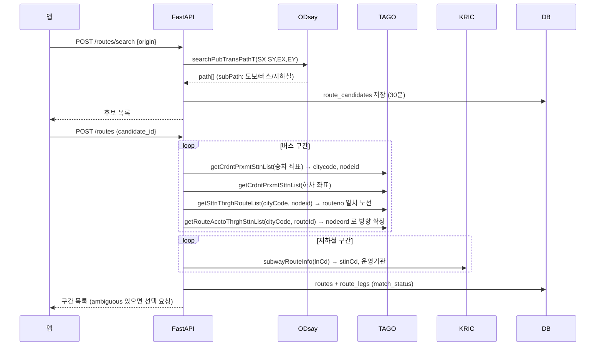

# ODsay → TAGO 연결과 FastAPI 설계 (방법 v0.1, 구현 전)

범위: 사용자가 정한 출발지 → 안양대 경로를 **ODsay로 검색**하고, 버스 구간은 **TAGO 버스 API**에, 지하철 구간은 **KRIC**에 연결해 FastAPI로 제공한다.
근거: ODsay 레퍼런스(searchPubTransPathT), 국토교통부 TAGO 버스 3종 활용가이드 v1.0 (정류소·노선·도착), KRIC 명세. 2026-11-10 확인.

---

## 1. 역할 분담

| 단계 | API | 언제 |
|---|---|---|
| 경로 후보 검색 | **ODsay** `searchPubTransPathT` | 경로 등록·변경 시만 |
| 버스 구간 → TAGO ID 연결 | **TAGO** 정류소·노선 API | 등록 시 1회 |
| 버스 배차·첫차·막차 | **TAGO** `getRouteInfoIem` | 매일 새벽 캐시 |
| 버스 실시간 도착 | **TAGO** `getSttnAcctoSpcifyRouteBusArvlPrearngeInfoList` | 당일 출발 전 |
| 지하철 시각표 (급행·열차번호) | **KRIC** `subwayTimetableExp` | 매일 새벽 캐시 (TAGO 지하철은 급행·열차번호가 없어 쓰지 않음) |

## 2. ODsay → TAGO 연결 방법 (버스 구간 하나당)

ODsay 버스 구간(`trafficType=2`)에서 쓰는 값:
`lane[].busNo`(노선 번호), `startX/startY`(승차 정류장 좌표), `endX/endY`(하차 정류장 좌표), `startName/endName`, `stationCount`, `sectionTime`.

```
① 승차 정류소 찾기
   TAGO getCrdntPrxmtSttnList(gpsLati=startY, gpsLong=startX)        ← 도시코드 없이 좌표만으로 조회 (반경 500m)
   → 후보 [{citycode, nodeid, nodenm, gpslati, gpslong}, ...]
   → 거리 가까운 순 + 이름이 startName 과 비슷한 순으로 정렬
   ※ 이 응답의 citycode 를 이후 모든 TAGO 호출의 cityCode 로 사용 → ODsay 도시코드와 TAGO 도시코드를 맞출 필요 없음

② 하차 정류소 후보도 같은 방법 (endX, endY)

③ 노선 찾기
   승차 후보마다 TAGO getSttnThrghRouteList(cityCode, nodeid)
   → [{routeid, routeno, routetp, startnodenm, endnodenm}, ...]
   → routeno == ODsay busNo 인 노선만 남김

④ 방향·정류소 확정 (같은 이름 정류소가 길 양쪽에 있는 문제 해결)
   남은 노선마다 TAGO getRouteAcctoThrghSttnList(cityCode, routeId)
   → [{nodeid, nodenm, nodeord, updowncd, gpslati, gpslong}, ...]
   → "승차 후보 nodeid 의 nodeord < 하차 후보 nodeid 의 nodeord" 인 조합만 채택
     (순환 노선은 같은 정류소가 두 번 나오므로 하차보다 앞선 순번)
   → 정거장 수(하차 nodeord − 승차 nodeord)가 ODsay stationCount 와 같으면 신뢰도 높음

⑤ 저장 (route_legs)
   tago_city_code, tago_route_id, tago_board_node_id, tago_alight_node_id, board_node_ord,
   match_status = ok | ambiguous | failed
```

결과 판정:

| 결과 | 처리 |
|---|---|
| 조합 1개, 정거장 수 일치 | `ok` → 자동 저장 |
| 조합 여러 개 또는 정거장 수 불일치 | `ambiguous` → 앱에서 후보 정류소(이름·방면)를 보여 주고 사용자가 선택 |
| 조합 없음 | `failed` → 1) 같은 구간의 대안 노선(ODsay `lane[1..]`)으로 재시도 2) 그래도 없으면 그 구간은 ODsay `sectionTime`·`intervalTime`만으로 계획하고 실시간 없음 표시 |

> 확인할 가설 (키 발급 후): TAGO ID가 "지역 접두어 + 지역 BIS ID" 형식이라면(예: 대전 `DJB30300002`), ODsay `busLocalBlID`·`startLocalStationID`에 접두어만 붙여 ①~④를 건너뛸 수 있다. 맞으면 빠른 경로로 쓰고, 위 좌표 방식은 검증·예비로 남긴다.

## 3. 지하철 구간 (변경 없음)

ODsay 지하철 구간의 `startName/endName` + `lane[].subwayCode` → KRIC `subwayRouteInfo` 역 목록에서 이름으로 `stinCd`·운영기관 코드 매핑 (`transit/route_search.py`의 `resolve_subway_codes`).
매일 KRIC `subwayTimetableExp`(승차역·하차역)를 받아 열차번호로 조인 (`transit/planner.py`).

## 4. 매일·당일 계산에서 TAGO 사용

| 시점 | 호출 | 쓰는 값 |
|---|---|---|
| 매일 03:00 | `getRouteInfoIem(cityCode, routeId)` | `intervaltime`(평일 배차, 분) → 최악 대기, `startvehicletime`/`endvehicletime` → 첫차·막차 밖이면 경로 불가 |
| 당일 출발 알림 20분 전 | `getSttnAcctoSpcifyRouteBusArvlPrearngeInfoList(cityCode, nodeId, routeId)` | `arrtime`(초), `arrprevstationcnt`(몇 정거장 전) |

TAGO 실시간 호출에는 정류소 순번이 필요 없다 (`nodeId`+`routeId`만). 경기 API의 `staOrder`보다 단순하다.
배차는 평일 값 하나뿐이라(최소·최대 구분 없음) 계획 시 대기 = `intervaltime`을 그대로 쓴다.

## 5. FastAPI 설계

### 5.1 모듈 구조
```
app/
  main.py                 FastAPI 앱, 라우터 등록
  routers/routes.py       경로 검색·등록·수정
  routers/plans.py        날짜별 계획·실시간
  services/registration.py  ODsay 경로 → 구간 변환 → KRIC·TAGO 연결 (2절)
  services/planning.py      planner.plan_commute 호출, 캐시 사용
  clients/odsay.py  clients/tago.py  clients/kric.py   (외부 API, httpx 비동기)
  jobs/daily.py           03:00 캐시 갱신 + 계획 생성 (APScheduler)
  db/                     SQLAlchemy 모델 = schema.sql
transit/                  지금 있는 순수 로직 (planner, route_search) 재사용
```

### 5.2 엔드포인트

| 메서드·경로 | 요청 | 응답 | 내부 호출 |
|---|---|---|---|
| `POST /routes/search` | `{origin: {lat, lng}}` (도착은 서버에 안양대 좌표 고정) | 후보 목록 `[{candidate_id, total_min, transfers, legs_preview}]` | ODsay 1회. 원본은 `route_candidates`에 30분 보관 |
| `POST /routes` | `{candidate_id}` | 저장된 경로 `{route_id, legs: [{seq, kind, minutes, ..., match_status}]}` | 2절 ①~⑤ (버스 구간당 TAGO 3~6회), KRIC 역 목록 |
| `GET /routes/me` | – | 현재 경로와 구간 | DB |
| `PATCH /routes/me/legs/{seq}` | `{board_node_id?, alight_node_id?, route_id?, minutes?}` | 수정된 구간 | `ambiguous` 해결용. 선택값 검증에 TAGO 경유정류소 1회 |
| `GET /routes/me/legs/{seq}/options` | – | `ambiguous` 구간의 후보 정류소·노선 | 등록 시 저장해 둔 후보 |
| `GET /plans?date=YYYY-MM-DD` | – | `{target_arrival, depart, prep_start, steps, info_basis, warnings}` | 캐시만 사용 (없으면 KRIC·TAGO 즉시 조회) |
| `GET /plans/{id}/realtime` | – | 버스 구간별 `{arrive_in_sec, stops_away}` | TAGO 도착 1회/버스 구간 |

### 5.3 요청 흐름 예 (경로 등록)


### 5.4 운영 규칙
- **키**: `ODSAY_KEY`, `DATA_GO_KR_KEY`(TAGO), `KRIC_KEY` 는 서버 환경변수. 앱에는 넣지 않는다.
- **ODsay**: 키가 서버 IP 등록 방식 → 배포 서버 IP를 ODsay 콘솔에 등록. 개발 중에는 개발자 PC 공인 IP 등록.
- **호출량**: TAGO 개발계정 하루 10,000건. 등록 1회 ≈ 버스 구간당 최대 6회, 매일 노선당 1회, 실시간은 사용자·버스 구간당 1~3회 → 파일럿 규모에서 충분.
- **타임아웃·재시도**: 외부 호출 5초, 1회 재시도. 실패 시 캐시 사용, 없으면 `info_basis='none'` + 안내 문구 (PRD 3.2).
- **에러 응답**: 외부 API 실패는 502 + `{code: "TRANSIT_UNAVAILABLE"}`, 매칭 실패는 200 + 구간 `match_status='failed'` (사용자가 고칠 수 있게 등록 자체는 성공시킴).

### 5.5 DB 변경 (schema.sql 반영은 구현 때)
`route_legs`에 추가: `tago_city_code`, `tago_route_id`, `tago_board_node_id`, `tago_alight_node_id`, `board_node_ord`, `match_status`, `match_candidates JSONB`
신규 `route_candidates(id, user_id, origin, raw_path JSONB, created_at)` — 30분 뒤 삭제.
`bus_routes`의 키를 `(tago_city_code, tago_route_id)`로.

## 6. 키 발급 후 확인 순서 (구현 전에)

| 순서 | 확인 | 명령 / 방법 | 실패하면 |
|---|---|---|---|
| 1 | TAGO가 서울·경기(안양·군포·수원 등)를 지원하는지 | `python -m tools.check_transit_api --tago-cities` | 미지원 지역 버스는 서울·경기 API 사용 (`transit_api.md` 6절 설계 그대로) |
| 2 | ODsay 실제 응답 필드가 문서와 같은지 | `--odsay` 로 경로 1개 받아 `api_samples/` 저장 | 변환 코드(`route_search.py`) 수정 |
| 3 | 좌표 → TAGO 정류소 매칭 성공률 | 서울→안양대, 경기→안양대 경로 몇 개로 2절 ①~④ 수동 실행 | 반경·이름 비교 규칙 조정 |
| 4 | TAGO ID = 접두어 + 지역 BIS ID 가설 | 3의 결과에서 `nodeid`/`routeid` 와 ODsay `startLocalStationID`/`busLocalBlID` 비교 | 좌표 방식만 사용 |
| 5 | TAGO 실시간 `arrtime` 이 실제와 맞는지 | 안양역 정류소에서 한 번 비교 | 실시간은 안내용으로만 사용 |

### 키 신청 목록 (모두 무료)
- data.go.kr: 국토교통부_(TAGO)_버스정류소정보, 버스노선정보, 버스도착정보
- openapi.kric.go.kr: 열차별 운행시각표(급행), 노선 구성역 정보
- lab.odsay.com: 무료 유형 앱, 플랫폼 "서버"에 IP 등록
